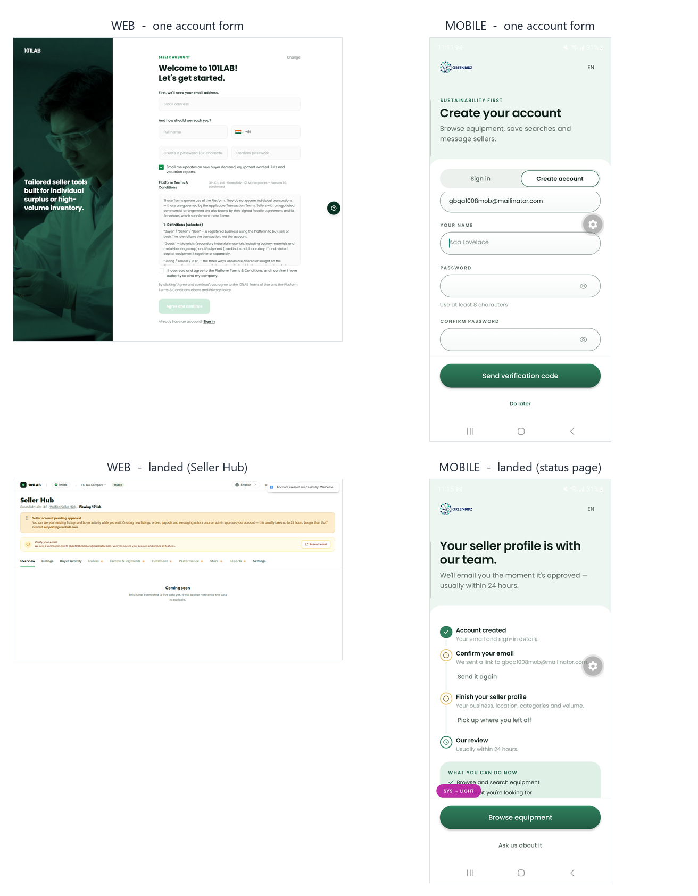

# Signup: `staging-lab.greenbidz.com/auth2` vs GreenBridgeApp

Walked end to end on 2026-10-08, both to a logged-in screen. Web in a clean isolated browser
context (the existing profile was already signed in, which would have made the walk pass for the
wrong reason). Mobile on the SM-G781B over USB, real accounts created on the dev backend:

| | account | outcome |
|---|---|---|
| web | `gbqa1008compare@mailinator.com` | Seller Hub, pending approval |
| mobile | `gbqa1008mob@mailinator.com` | seller home, "1/4 · Waiting for approval" |



---

## The steps, side by side

| # | Web `/auth2` | Mobile |
|---|---|---|
| 0 | **Role chooser** — "How would you like to use 101LAB?", buyer card and seller card, each with Log in + Register | *(none — one generic account)* |
| 1 | **Account form** — email, full name, phone + country, password, confirm, marketing opt-in (pre-checked), full Platform T&C in a scroll box, "I have read and agree" checkbox, Agree and continue | **Account form** — email, your name, password, confirm password, passive "By continuing you agree to our Terms of Service and Privacy Policy", Send verification code, Do later |
| 2 | *(no email step — lands straight in the wizard)* | **Email OTP** — "Check your email", 6 boxes, auto-submits on the 6th digit, "Resend in 9s" |
| 3 | — | **"Account created"** success screen → Start browsing |
| 4–9 | **6-step wizard**: reseller/company · company name + website + VAT/tax ID + job title + business phone · address + city + postal + state + country · equipment categories (multi) · volume · calibration → **Submit for review** | **The same 6-step wizard**, reached afterwards from the status page's "Pick up where you left off" |
| end | **Seller Hub** — pending-approval banner, verify-email banner with Resend, tabs with padlocks on the locked ones, "Coming soon" | **Seller home** — "Finish setting up your account 1/4 · Waiting for approval", and a status page with a 4-step timeline, "What you can do now", Browse equipment |

**The wizard is not missing from mobile.** It exists, with the same first question and the same
Reseller / Company options. The difference is placement: web runs it inside signup, mobile runs it
after the account exists.

---

## ⛔ Why mobile signup cannot simply be made to match

The web account form and wizard collect **company name, VAT / tax ID and business type**. Those are
three of the four items **App Review rejected this app for, twice** under Guideline 3.1.1 — builds
1.0.0 (14) and 1.0.3 (19), 2026-08-20.

Apple said **remove, not move**:

- shifting them out of signup into a separate in-app form was rejected *again*, because they were
  still in the binary;
- a feature flag is not a fix either — Guideline 2.3.1 names features disabled at review and
  enabled afterwards;
- an outbound link to a web page carrying a Company field caused a **third** rejection, which is
  why `app/(lab)/sell/apply.tsx` deliberately has no outbound link.

The constraint is written into the code: `app/(auth)/register.tsx:13-17` and the "DO NOT PUT IT
BACK" block at `app/(lab)/sell/apply.tsx:12-48`. Business verification still happens — on company
name, tax number and certificate — but **off-app, by the team**, with
`src/features/seller/sellerSubmitGate.ts` gating who may publish.

So "make mobile match web" is, taken literally, the move that got the app rejected. What follows is
split accordingly.

---

## 🐞 Production defect found while walking this

**Both entry points into the onboarding wizard bounce a signed-in seller to the login screen in a
release build.**

`app/(auth)/onboarding-mock.tsx:27` is `__DEV__`-only by design and correctly so:

```tsx
if (!__DEV__) return <Redirect href="/(auth)/login" />;
```

But two production paths push to it with no `__DEV__` guard of their own:

- `app/v2/account-status.tsx:154` — the "Pick up where you left off" action, which its own comment
  calls "THE ONLY DISCOVERABLE WAY BACK INTO THE WIZARD"
- `src/features/seller/sellerSubmitGate.ts:156` — where a seller with unfinished onboarding is sent
  when they attempt to publish

In a shipped build both land on `/(auth)/login` while the user is already logged in. Not a 3.1.1
problem — the business fields never render — but a dead control on the one path back into the flow,
and a publish attempt that ends at a login screen. Verified by reading both files: neither contains
`__DEV__`.

Decide the flow question before shipping either path, or gate both call sites to match the route.

---

## Differences worth closing (safe under 3.1.1)

1. **No role chooser on mobile.** Web asks buyer-or-seller first; mobile creates one generic
   account. This is arguably correct for mobile, but it leaves the next item.
2. **The signup copy is buyer-framed, the landing is seller-framed.** Mobile signup says "Browse
   equipment, save searches and message sellers", then lands on "What are you selling today?" with
   a seller setup card. Pick one promise.
3. **"Apply to sell from the Sell tab" names a tab that does not exist.** The mobile success screen
   says it; the tab bar is Home · Browse · Matches · Messages · Account.
4. **No per-field inline errors on mobile signup.** Web shows "Phone number is required" in red
   under the offending field with a red rim; mobile signup has no equivalent.
5. **Terms are a checkbox on web, a passive sentence on mobile.** Web requires an explicit "I have
   read and agree … and I confirm I have authority to bind my company" and shows the full T&C
   inline; mobile says "By continuing you agree". If the T&C acceptance has to be *recorded*, the
   passive line may not be enough — worth a legal answer, not a UI one.
6. **Progress labelling disagrees.** Web counts "STEP 1 OF 6"; mobile signup counts "STEP 1 OF 2"
   and then the wizard restarts at "STEP 1 OF 6". A seller sees two different step-1s.
7. **Country picker: mobile now has flags, web does not.** Mobile's picker shows each country's
   flag (added 2026-10-08); web's is grouped by region and searchable with no flags. Converging is
   cheap either way — pick one.
8. **Web has no email verification step in the flow**, only a banner afterwards; mobile blocks on a
   6-digit OTP before the account is usable. Different security postures for the same account.

## Differences that must NOT be closed

- Company name, VAT / tax ID, business type and any certificate upload stay off the mobile binary.
- Do not add an outbound link from mobile to the web signup to "reuse" it.
- Do not put the wizard behind a remote flag.
